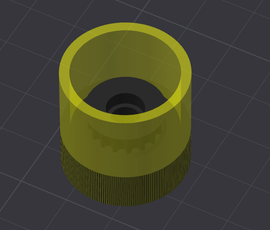
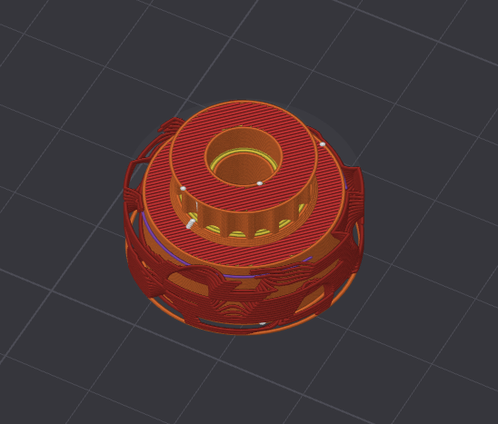

# Onshape Source
[this link](https://cad.onshape.com/documents/e3248e877542224530ec66b3/w/ab92461b2a6e790aee280646/e/01c1a3ee09cbe98f66df6cb1?renderMode=0&uiState=6a713f1a6f7a0d63159b477b) is the onshape source document!

Additionally the other file is the step file is the configs of the robot!

Print settings in the [BOM.csv](BOM.csv)

# Wheel Print Settings WIP

- You make the bounding box a modifer and set it to zero walls, top and bottom layers

|  |  |
|---|---|