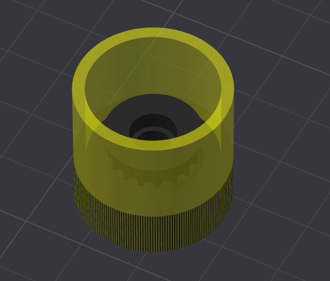
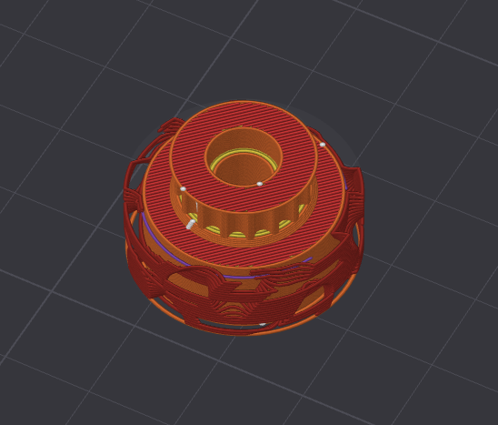

# Onshape Source
[this link](https://cad.onshape.com/documents/e3248e877542224530ec66b3/w/ab92461b2a6e790aee280646/e/fed24172c8202cb512c7850d?renderMode=0&uiState=6affe14080700629930dd565) is the onshape source document!

Additionally the other file is the step file is the configs of the robot!

Print settings in the [BOM.csv](BOM.csv)

And the drawing of the custom weapon axle is [here!](Weapon%20Axle%20Drawing%201.pdf)

# Wheel Print Settings WIP

- You make the bounding box a modifer and set it to zero walls, top and bottom layers

|  |  |
|---|---|