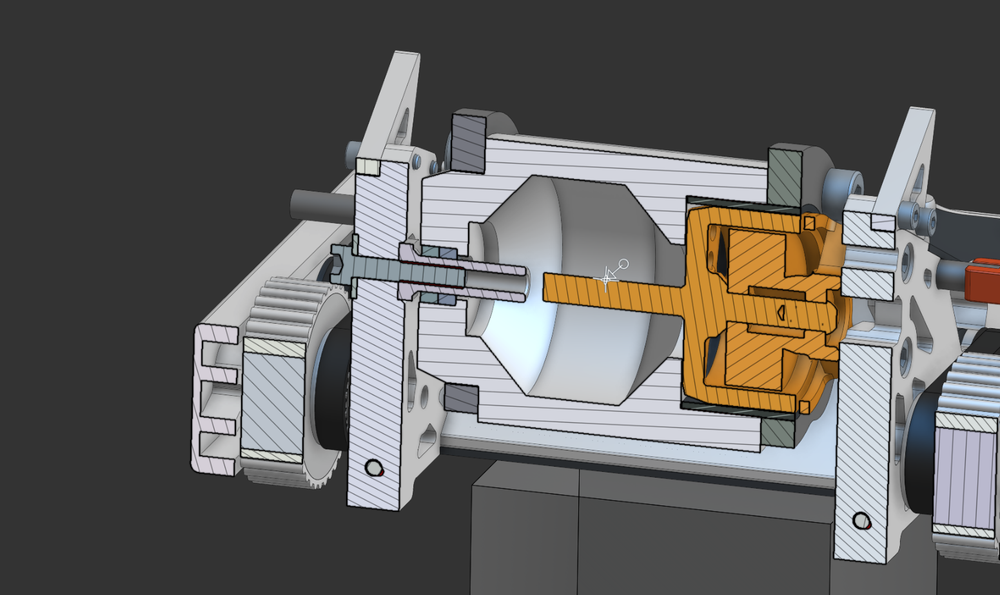
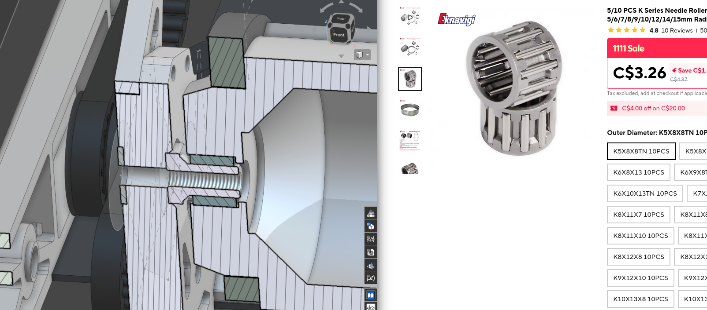
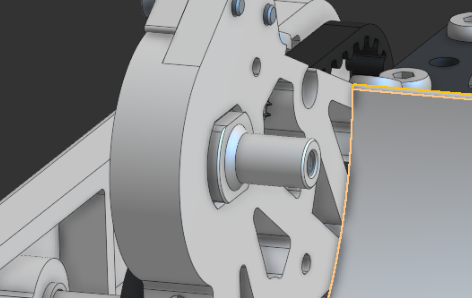
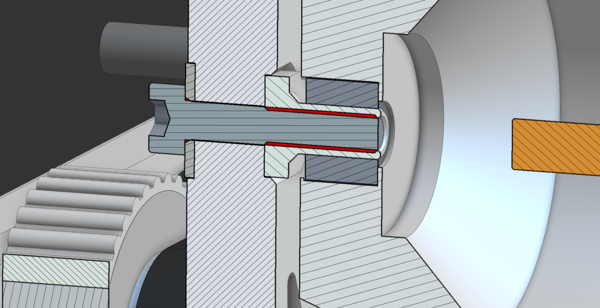
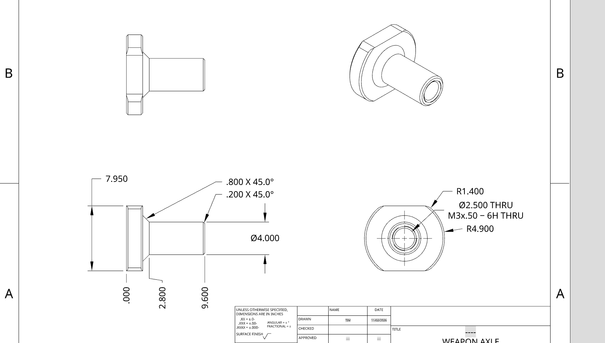
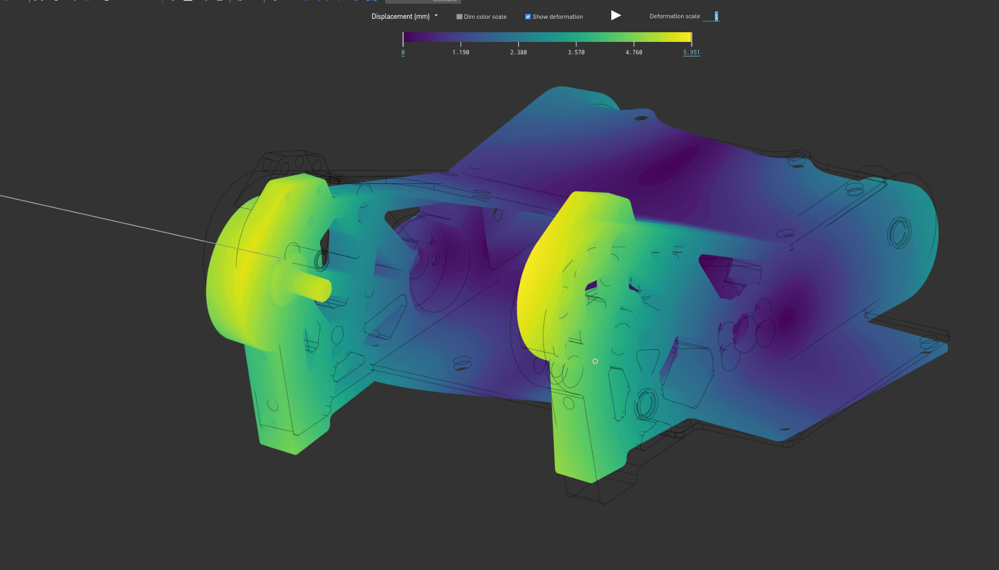
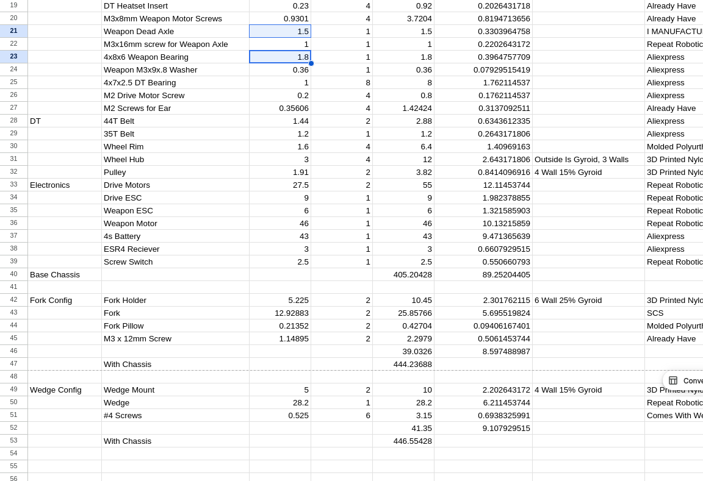
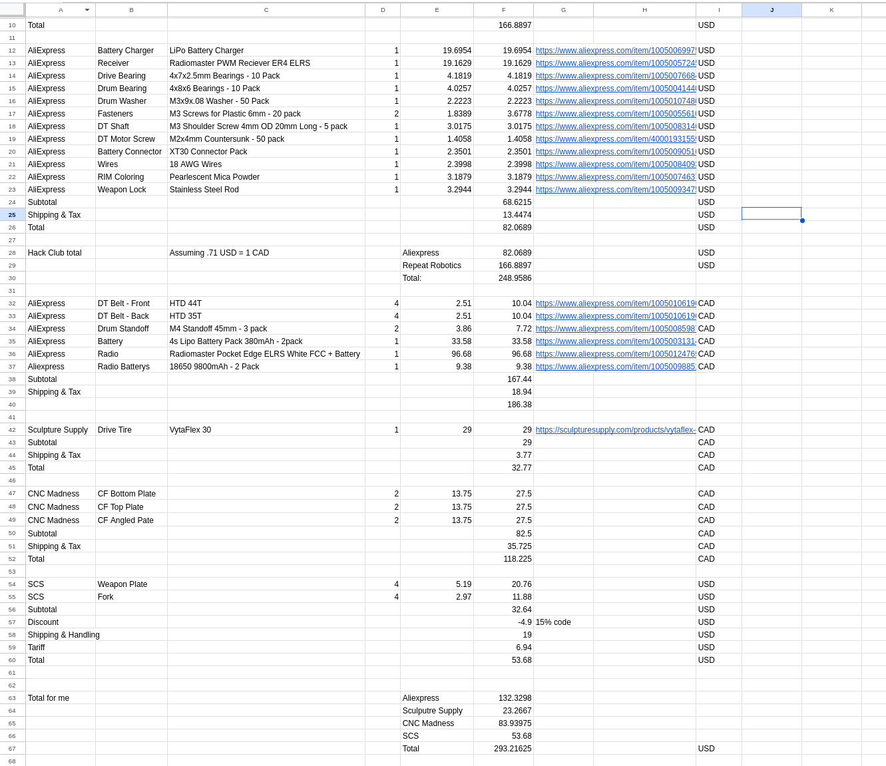

# 2026-11-08: Regrouping

**Total time spent: 2.4 hours**

### Rejected from Macondo 
- So my project after many months got rejected from macondo see full reason here: https://macondo.hackclub.com/projects/10896
- Long story short they thought my project was too simple for how expensive it was, additionally my demo didnt work?? even though the onshape link did
- So then I got my project moved over to fabricate over forge since their T2 budget + rewards were better! 
- Addiitonally they end earlier so I could also get build rewards which would be nice

### Weapon axle upgrade
- After speaking to some people at my university about my design, who had much more experience then my they said that its not great that I'm using normal bearings there over needle ones, since they spread the load much more evenly

- I had considered this before although due to me only being able to source aluminum axles that have the flange on the end from repeat robotics (It needs the flange so then it could spread the load much more evenly on the 3d print) I was stuck with the normal ones
- Then I realized that I'm in university now with access to a machine shop where I could custom mill my own, which would make it much more optimized as then I could use steel!

|||
|---|---|
|||

- I also optimized the length here so its the minimum distance needed to contact the full bearing and I made it m3 with a 4mm OD so I could basically min max the material there and use the smallest needle bearings I could get my hands on
- also I was slighly concerned with the strength of this so i threw it into the simulation and it looks fine (knock on wood)

- And after all that I got to save 1-2ish grams over the original setup while having this be much stronger

### BOM Update
- I also now split up the sections to what hackclub pays and what I would need to supplement outa pocket :/
- Since the budget here is lower
- In addition to removing the old weapon axle, and adding in the new weapon bearing
- I also moved around some stuff so it would be easier for it to be imported into the fabricate BOM thing but i realized its really annoying espically with my format so ima just ask if i really have to and call it for today https://hackclub.slack.com/archives/C0C1C5UEZND/p1794199099719589 

also minor note this spans multiple days because I just didn't have enough time to make the writups and the thing at in the same day so yea!

# 2026-08-06: Submitting!

**Total time spent: 1.5 hours**

# Checking with Community
- I sent this message in macondo help, although I don't think anyone will respond as its been hours and my last thread about something similar got kinda ghosted.

## Going Through the Checklist

- Here I wrote some stuff about the project that I wanted the reviewer to know, such as how I plan to pay for the spare
- Also I talked about the lost blender file and how I'll remake it while I wait for the parts to arrive

- And then I went through all of this:

### I added the wiring diagram 

- I only added imgs of the more complex to wire components as they are the only ones that need it
- Its also because the other ones had no nice imgs

Before n After:

|||
|---|---|

### Adding the 3DP parts

- I decided to do step files since they still provide the og data and are much higher quailty then the STL files

- I also finally took the time to add a modifer and update the readme there, although I cant actually give instructions until I have made sure they work, this also applys to the molds
- I'll also add the print orientations & mold instructions etc once all the parts are finalized to have a physical working robot, and I make sure they work
- Instead of allowing someone else go out and buy all this stuff just to find out this doesn't work

### Commiting & Submitting!!!

- Cya for a while as I'm a bit burnted out from this project esp to the level of polish, even though this is still far from done, bc I still havent competed with it and trident tested it

# 2026-08-05: Updates/Basically Done

**Total time spent: 1.5 hours**

### Outer Rail Delima
- So here I was really considering putting the screw back to like how it was before where it would be parallel to the rail, as this would allow a screw to be screwed in at the top spot of the wedge in that config

- I pondered for a while about this, and I think ill just leave it for now and probably figure it out IRL since I have no battle experience with it to see its weaknesses and how it breaks

- I also decided to add some material there so that its easier to align + there is no chance of something attacking the inner part of that wedge part

### Updating Weights After new Changes

- And due to the extra weight I could afford to change these two parts to 4 Wall instead of 3 :D

### Updating Receipts + Spreadsheets
- After I changed to those screws I had to update the screenshot for the aliexpress cart

- I also made the repo public and now have the macondo thing link to this instead of the onshape :D

And here is where I need to call it for today since a new robot released on mosim and I needa get 1050+ on it since I actually stand a chance rn

# 2026-08-04: Reducing Chassis Size by 5mm + Github Update

**Total time spent: 2.5 hours**

### Changing to Countersunk screws
- I was thinking since I'm already trying to use some neish screws that would be difficult to be reused anywhere, might as well go the distance and get the right ones for this application
- So now going with these counter sunk they are slightly lighter and allow for more distance between the motors so wiring could be easier

- and then I realized I could do a big brain play to reduce the width of this drum from a 45mm long standoff to a 40mm so then I could 
- Although this is a slight gamble since Im relying solely on 2mm of nylon to hold this motor in place, but on the other hand it shouldn't be taking any hits since it uses belts to power the motors righttt
- Since this space is now 6.5mm and I could just stager the motors to allow for cable management and yea!

- this is some crazy strats that I'm using,

- Although 2 problems came up so far with the motor shaft now pocking out and the wedge holder not being in great shape with its screws which I'll fix tmr, in addition to updating the weights since its getting kinda late for me, todo today 

## Github
- I added to the github readme with some imgs and describing more about the robot, although after the changes I just made I'll probably need to update the renders and pictures of the robot
- I also just described some of the features so far although its not too extensive so far as I am kinda tiredrn and this will be for another time

- Also the github is still private until I have it finished enough that I feel confortable publishing it!

# 2026-08-03: Almost Ready to Submit!

**Total time spent: 2.0 hours**

- Just as a note I was jumping around these, but I had to present this as linear soooo...

### Belt :/
- This was the belt that I was originally gonna get although I didn't realize that their shipping is SO expensive
- so I switched to this one which is much cheaper and better after some searching!
- its also unmarked so thats nice!

|||
|---|---|

### Spread Sheet Update
- I updated the spread sheet now having so that the weight distro also says the source and then yea!

||||
|---|---|---|

- so now its more of a coherent BOM and sourcing guide, also thats the math page taht I didn't really update

### Carts

- I wont be sharing the specific screenshots but here ya go, of the imgs and amount i requested (I ended up changing the total cost to 400 since I missed smth about shipping)
- it was pretty annoying doing the aliexpress thing agian since there were so many items

## Making a repo
- I was reading through the docs and it mentioned I needed a repo if i were to fully submit the project soo
- I started that and made it
- I added the spreadsheet stuff but I'll commit it tmr after I got more of the stuff ready

### I am so dumb.

- While making the github repo and collecting all my source files I realized that when I was working on my blender render, I never actually saved the file anywhere. I was just working on the temp and last saved.... I'm so done rn so I'm just gonna upload the imgs and just leave this for now, and at a later date... :/

# 2026-08-02: Fork Adjustment + Weapon Lock + Wiring Diagram

**Total time spent: 2.5 hours**

### Minor Fork Bite Change
- I changed up the fork so then the bite on it is a bit further back and slightly shorter

|||
|---|---|
- I also beefed up the fork holders in print settings so that both configs are around the same weight now

### Weapon Lock
- I was considering the drawing I made a while ago, although that is alot of design work and likely still would impact practice driving which is not great, since it extends back and down
- so I gave the through rail idea a shot again:

||||
|---|---|---|

- I looked into a bunch of pins that I could use such as locking pins, or the ones that loop around in the end. And then I realized that I could just get a normal m4 rod and just 3dp something on the end of it to add like a banner
- And its so much cheaper
- The reason I'm chosing m4 over m3 or m2 is becasue just the strength and safetly as I wouldnt wanna risk a smaller diameter rod get ripped through when I'm powering this on for the first time. 

||||
|---|---|---|

- The second img above is my first attempt although I think its a bit too bulky for its use to hold a keychain ring
- the third img above is my attempt at a banner with the different fonts and I just couldn't figure something out that looks nice so this will be a later thing!

- I also made a assembly for it and added the configuration for it in the main assembly
- And I have the new 3dp end thats much sleaker and easier for the ring to go over it!

|||
|---|---|

### Wiring Diagram
- This is one of the most painful things I've had todo for this project
- I based the placements off where they would actually go IRL

- This is the wiring diagram for all of the components
- I have it so that its more simplified as the actual parts have the symbols on them to show specifically but I tried my best to show were the wires would actually go on everything 

.png)

- I also have it here so that the wires to the reciever that arent carring as much power are smaller, and that the pwm pins are diff colors
- Below are the diagrams for the actual components!

||||
|---|---|---|

# 2026-08-01: Fork Optimization

**Total time spent: 1.0 hours**

### Better Ground game
- I came across this [google slide](https://docs.google.com/presentation/d/1Qw9ARvcOfnJ-cOwN4zUewAMJ5Tnr1aHT4nnSRyM2G4s/edit?slide=id.g3c92b3a21fe_0_11#slide=id.g3c92b3a21fe_0_11) where it talks about strategys for ground game and I realized that mine  are still a bit sub optimal
- So in there it talked about that there should be a flat part at the end so that the fork could more easily ride on the floor, so I added that

- Additionally IRL I could do something like this

|||
|---|---|

- I also made the pillow for this a bit smaller as it can make sure that this fork can sit there

### Minor Plate fix
- Originally this plate was left off with a weird number and it had no clearance so I fixed it up and IRL this part could be more easily checked if its good

||||
|---|---|---|

- I also moved the screw up a bit for the CF plate just incase I wanted the through plate design for the weapon lock, and just so that it could support the drisk better.

### Document Organization
- I moed the imported parts to a nother folder instead of keeping it in the sub asseblys one so its cleaner

### Weight Updates

- I also updated the weights for all the changes I made so far and I'm thinking at the weight difference between the fork config and the weidge I could get away with chanign the 3/16" fork to like 1/8" and add another outside set...

# 2026-07-31: Reduction in Battery Clearance + Rendering!

**Total time spent: 3.4 hours**

### BOM Update
- Turns out that SCS has these fees that I weren't aware of before soo:

- I also looked into ready set cut, as their local although they only had 3/16" ar400, or 1/8" ar500, both unsuitable for my forks and spinner that use 3/16" ar500 for that bigger area
- They also weren't even that much cheaper so I think I'll just go with SCS 

- I also realized that the sculputre place is only like 3hr away 2 ways so I could just bus there to save on the shipping!
- Below is now the updated BOM

### Chassis Upadtes
- I changed up the clearance so that its 1.1->1.5mm to the screw head to the ground
- Additonally changing the wheel diameter from 28 -> 27mm, overall changing the inside up down clearance to the battery to 2mm, allowing for some buffer so if the CF gets hit the battery isnt crushed instantly
|||
|---|---|

-Some photos of me fixing the main partstudio now

|||||
|---|---|---|---|

-I also adjusted the wedge to have a better transitiion into the upper guard

|||
|---|---|

### RENDERING!!!
- I followed [this video](https://www.youtube.com/watch?v=0B0OUAdQ6UI) and a problem I ran into is that they downloaded the onshape assembly as a collada file, although onshape removed support for that
- So I did some googling and then ended up finding out that the GLTF file type does basically the same thing!

- While assigning the materials I only chose to do the materials for the ones that are showing and avoided ones like the battery and parts of the drive motor 

- I also used like some fabric matrial for the belt since thats what it most looks like
- Additionally I used some like painted metal or plastic for the nylon and motor

- While rendering the image I ran into some problems, I was originally using my cpu so it was gonna take like 40mins vs the 1min 30s on my gpu
- It was also crashing, so after some googling  I found out it was bc I was using opengl instead of vulkan which would be more stable for me

- I also changed the background from the tutoral from smth white to grey paint as I think it looks nice against the white robot!

- After this image rendered however I noticed that the bottom backdrop, the fillet from the floor to the walls looks a bit weird which I'll fix in the next render!

# 2026-07-30: Outside Rail Fix + Weight + BOM

**Total time spent: 2.5 hours**

- A few days ago I noticed this problem, where the outside rail doesnt follow the fillet and the upper corner just doesn't work

### Changing the Block CAD First
- I changed up the geometry so then I could have a flat part there and there is no curve on the wall
- This allows for the the outer rail point to be a bit shorter which helps the problem, and also unintentionally help the guard have  some better geometry to the drisk if somethings getting flung up from there

|||
|---|---|

### Fixing the Fedility CAD
- I don't think I mentioned this yet but I just gave up on naming everything here because its just too much work and time :/

|||
|---|---|

- In the second image above I started to notice that the screw heads on the outside rail would stick out too much creating a point for other robots to grab onto which is not great, so I messed around more with the geometry
- And in the second img below I just realized I could move it more inward
- Although this rail still had the problem with that interference with the wedge....

|||
|---|---|

### Lofting the Bolt Guard
- Here I first tried a few sketches but eventually landed on doing a cutout on the outside rail and loft feature on the below highlted orange

|||
|---|---|

- Now this looks nice and doesnt have the interfereance with the wedge!
- Below I started to rebuild everything else in the high fedility CAD and the part lighten feature script kept giving me a hard time :/
- its hard to tell but basically initally I would have a rectangle at the front, and that would be  a exclude feature, but after narrowing it  down for a while I figured that was at fault and I just did a offset thing, and then it worked! 

||||
|---|---|---|

- And thats what the outside rail looks now :D

### Adding 4th Hole Support
- Since I have more room now, changing the outside rail I added the hole for the 4th hole
- Although its unlikely I'm gonna use all 4 due to weight, but I'll see
- I had to pull something fancy to get the fillets to cooperate but it worked out!

|||
|---|---|

### Current!

### Weight Update
- I made a little section for each config and added and updated the changed parts
- This is an okay but not the best spot to be in because this estimate uses the full length wires on the escs and headers on the radio
- But no wires to the drive motor, nor to the switch and battery connector :/

### BOM update
- I finally updated it and counted how much of the hackclub budget I would use
- I also made sure to convert it from CAD to USD for that part
- Additionally I added the 18 AWG wires, for the drive motors. I was considering 20 but I wanted to play it safe

# 2026-07-29: Assemblys + Configs :D

**Total time spent: 1.4 hours**

### High Fedility Wedge Part Studio + Assembly

- I decided to now have the diff configs in different assemblys as then I could easily change configs between them
- To start that I made a different studio for this part so then my main one wouldn't get too cluttered, and I just derived whatever part would be in contact or effect the part im making.
- In the high fedility wedge I added the mounting to chassis screws, and some more fillets and clearances

- I made the assembly and I have it so that it would have all the mounting hardware
- I also found the #4 Screws CAD on mcmastercarr, but repeat didn't specify what length so I just chose the #4 and 5/16" long which should be fine

### Moving Fork Config To Its Own Assembly

- and this is the main assembly with both assemblys!

### Assembly Configurations
- I just figured out assembly configs on my own, somehow, but I am really happy as this is so cool, even though the two configs is just suppressing something
  - For the first time I felt like something I made was like truely like a pro :D

- While messing around with it I realized that the electronics werent like grouped or anything so I changed that

### Hero Shot of Configs!

- When I tried bringing them both into a assembly tho the wedge one just wouldn't cooperate

- And then when I just redid the mate from the part to the wedge it worked???? thanks onshape
- So now I have my such a good photo of the configs

# 2026-07-28: Block Wedge Improvements, Quotes, Other Optimisations

**Total time spent: 1.5 hours**

I changed the distance from the tip to the wedge 2.4->2mm, and thus that also reduced the size of the deflectors, which should be fine since they dont need to protect too far up

### Minor Note

- I was thinking of this mount more and I'm a bit concerned as I have it so that it screws into the inner rail parallel to the layer lines, which makes it slightly weaker
- The reason I cant change this at this point is I want the following wall there to secure the fork more

|||
|---|---|
- And right now there isnt even space behind the fork for a screw that could go behind it to the inner rail
- This is just to explain my thoughts rn, as later on I might change this out and come up with a better solution 
- That shouldn't be too hard since this doesnt affect the geometry of any of my custom plates, only MAYBE the forks. But I need some more experience with this robot in what it can or cant take.

### Last Quote Received & Spread Sheet Update

- I dont think I have ever been so upsold in my life or maybe this is just how expensive waterjetting is
- THIS IS NOT INCLUDING MATERIAL BTW
- So I think its safe to say that I'm gonna go with CNC madness and SCS for the parts which I got quotes for already and their like a fraction of this n yea
- I updated the SCS order with the new things and yea! They might be one of the greatest companys of all time for giving me this good of a price and FREE shipping!

- I also added 2 extras of each that I'll pay for out of pocket.
- Updated part:

### Better Wedge to Chassis Energy Transfer
- The worst thing that this wedge can do is come off when its going against a wedge
- So I also noticed that I should probably have some more contact area with this so that it can transfer the energy into this robot more efficently instead of making the screws go out
- A before and after!

|||
|---|---|

### Oversight on Wheel Clearance
- On the fork config I forgot to make a cutout for the wheels on the holder. 
- Even though there is enough clearance if the wheel gets misaligned or it expands its gonna impact this robots speed.
- before and after!

|||
|---|---|

### Bigger Motor Wire Path
- I made it a bit bigger so I won't be in pain fishing it thru or if somehting pulls suddenly there can be a bit of slack so the solder joints don't pull
- Before n after
|||
|---|---|

# 2026-07-27: Countering Horizontals - Block CADing Wedge Holder!

**Total time spent: 1.0 hours**

My current config is good except against horizontals and overhead attacks. Today I'm gonna try and solve the former with a wedge. (as in botbrawl I havent seen a overhead attacking robot yet)

- I was watching this robot pinevictus, a very successful NHRL Robot which has a similar layout to mine except their 3lb vs my 1lb and they have a diff design language
- And against horizontal spinners they use a wedge, as it deflects it up till it gets to the vertical spinner and then yea!

- My initial idea was this with the curve sticking out, but if I wanted a guard at the end I would need some way to print this part properly, since i want the inner rail cover like the fork config did, and that config used the outside as the flat face to print everything on.

- Then I came up with this, solving that, although while writing this up I realized I could just use the inner side as then I could have the upper wall just extend there

- So this is what this! I also added a chamfer on the inside so I could save a bit of weight while maintaining the ease to print + strength of part.
- I also have it in the block assembly where I could hide and show another folder to show the diff configs!
- I am also gonna use max 3 probably 2 screws on this wedge on each side to save weight and I couldn't fit the very top one since it would interfere with the screw that secures this part to the outer rail!

- Here is also the partstudio view of it
- I have it so that I have a main sketch and then the other sketches for specific features in the folder, which I'll bring over (just the sketches) to the main partstudio.
- it was also kinda annoying to dimension this since its curved and using imperial

# 2026-07-26: More Weight Optimizations + Spinner Axle Support Improvement

**Total time spent: 3.0 hours**

### Sim Stuff

- These were missing some of their values so I just found some vals online for these n such, and I had to do the same with CF
- Although since the main assembly is so large it wouldn't let me sim and the sub assembly for the chassis would take a stupid amount of time to render, about 10 mins each iteration so I might later just try and make a optimized assembly
- But anyway I also have it so that I have a folder that I need to suppress (the electronics) to remove all the stuff that wouldnt help the sim in a folder now.
- I also had to mate the DT motors as I had them as a composite part before
 

## Weight Optimizations :D

### Fork Holder Optimization
- After Yesterday I was at 453.9g which is not a great place to be at being basically on the line so I changed the pivot screw from m4x16 to m3x12 reducing the weight by 3ish grams

- I think this will work because the main force is the shear force and surely my robot would be flung before this bolt and mount break right??
- I tried getting the SIM to work but its just breaking on me since this is such a big assembly so I might later on make a just bare parts to test

- I re sliced the rims now but with 3 perims as thats probably enoughhhhh, to save 4g overall

Now I'm down to this apposted to 453.9g 

## Spinner Axle Improvement

- When I asked in the discord for advice on this robot someone brought up that I should probably switch to these: 

- for the side that isnt held with a motor
- Although the weight works out as it would be like 4ish grams heavyer only, but the bearings are like 40grams compared to the 1 i was using before, and kinda expensive....

- So I just decided to go with these!

- Since their metric, with 5mm ID bearing compatibility, m3 screw and yea! 
- So im gonna cad this in right now.
- I am also on the otherside gonna have a big washer for the m3 bolt so then its spread over a big area, but not too big making the sides too ridgid and unable to absorb impacts
  - So I chose the 9mm here since I think the best value as the ones above it in size were $4-7 vs $3
 
- I also chose these bearings 5x8x2.5 and I'm gonna double up on them so the load is spread on the axle

- When Cadding this in I also decided to use a m3x16mm screw there so then its very hard for the axle to colapse in and cook everything
  - Additionally I like to design with me putting this together or making part swaps at comp in mind
  - So here I had it so that the axle not only sits into the hole, but has a chamfer and a little bit of clearance with the spinner
  - This allows for me to easily align into the hole where the axle flange is secured and I can just start screwing, but I can also squeeze this assembly between the two inner rails by flexing them a little bit.
  - While not having too much room that the spinner could move in a significant fashion

- While adding all the weights I decided instead of guessing the weight of the bearings with just assinging it as steel I should just google them

- And then I found out my DT bearings weight .49g -> 1.5g each, which is not great so I found a different one where isntead of 4x8x3, they are 4x7x2.5mm now weighing 1 gram each so I updated the dimensions and stuff (I also added the washer in the second img)
|||
|----|----|
- Bringing this robot back down to a weight that comfortable ishhh (this is without reslicing the wheels but surely collectively they cant bring the weight up even 1gram with a .5mm diff)

## BOM Update

- I just updated the BOM with all the changes to the robot so far!  
  - Diff belts, Standoffs, Bearings, etc.

## Quotes update
- I would first like to say thank you CNC Madness for being basically a charity and helping me out since this is around 3/4 of the price of the other one except I get all the plates instead of just the bottom one.
- they are just too crazy

- I still need to wait for the other waterjet place though, and then I'll add it to the BOM

# 2026-07-25: Math & Redoing Disk

**Total time spent: 4.7 hours**

- Initally I was just looking at some resources by searching through the nhrl Discord just to see what info I might be missing, and there was a bit...
- I found [this website](https://bdboxell.github.io/robocalc/) which was nice as it reminded me about spin up time on the spinner and how important that is 

|||
|----|----|

- While filling that out however I also realized that I have a LiPO but its HV meaning high voltage so that it can be like 17.4V which is nice, and able to get me to like 200-225ish mph which is within the range of comp
 - and I read that no matter the weight class 200-250mph tip speed is comp so this is good enough
 - I also found out that this MOI is good enough as I was concerned that I didnt have enough, but I realize now that if I have too much this weapon spinup time would be wayy too long 

- I made my own spreadsheet for configs that I would run and to test out if i could reach the aformentioned speeds!

- I also read through the [ask aaron](https://runamok.tech/AskAaron/spinner_FAQ.html) website again and it was informative ishh n yea.
- I got this spreadsheet from there and it was not helpful at all as I didnt realize until like 10 mins later this doesnt apply for my robot because i have a unconventinal Drisk Setup for which this doesnt account for

### Simulation 

- I learned how to simulate stuff in onshape by following the tutorial, although initially I kept running into errors with the parts, and then I realized it was due to my composite part and some materials just not having all the values it needed
- I ended up setting up 2 sims, one where its spinning at 30k RPM and experiences a 15kN force on one of the tips, and 2 on the second sim
- This allows me to accurately see where the hot spots are in each setup
- I also realized that the steel that i had was not ar500 so I made my own custom material to solve that with all the correct properties

|||||
|---|---|---|---|
|||||
|---|---|---|---|

- I tried a bunch of things to reduce the spot in the inner fillet but I ultimately landed on this, where it has a line from the arc to the inner arc
  - this strikes a balance between having a spot for bite and curvature. 
  - Also it was so annoying to iterate on because I would need to wait like 2mins for it to render out
  - Additionally I'm just accepting that at super high speeds and a good bite I'll just take the .5mm ish permanant deformation 

- When I went to the safety factor where if its below 1 itll bend, and the aluminum standoff is WAYYYY TOO MUCH 
- So I will need to get the Steel ones back :/
- - And the steel ones in the second img are better but not great since its still way below 1, but there is not much I can do since I am already so so close to the weight limit and there are other places I should be putting that weight towards. 

 |

and then I balanced this again with the new tooth design

|Not gonna lie this is something that I just don't understand enough of right now, nor have enough experience. So I'll probably have to redesign this spinner after the first comp or practice sessions I goto, and just cut my losses here as this DOES kinda follow the general shape for a good disk :/ | |
|---|---|

# 2026-07-24: Minor Optimizations + Spinner Lock

**Total time spent: 1.5 hours**

- I'm still waiting on the email back from the waterjet places :/

### Switching back to the round Aluminum Standoffs
- I was at 455g and thats not too great of a place to be 

- So I'll sacrifice the MOI for this weight reducion

- and now im at 447.6g :D
- But the MOI somehow stayed around the same????? 75k which is a nice spot to be at

### **VERY LITTLE**Fork Tinkering
- I tinkered with the geometry a bit to make sure that there isnt a spot where it could easily be ripped off

- but it still looks abit strange which is not great but it should do the job

- I also pocketed it with like 3mm walls so now im at 446.84g while it being a bit stronger in the further position

### Spinner Lock
- I forgot to make a harness for it, so that it wouldnt accedentally spin up when I dont want it to

- and then I realized that its unconstrained the other way which is not great + the screw driver can fall out if im trying to test the drive which is not great
- But I saw this solution on the beetleweight docs for beginners where they just put a 3dp there that goes around the robot 

- So I came up with a similar solution to that, but I drew it because its really late for me rn

- This way its something thats rests on the tip of the blade, and is between that and the body, so its contrained to not go clockwise
- And constrained counter clockwise, due to the the hook that spans to the back of the chassis
- I also added a gap between it so that there is a handle :D

# 2026-07-23: Quote Hunting & Dye for the Wheels

**Total time spent: 1.0 hours**

### Finding Alternatives
- an idea I had first is to just use PACF plates although its just not as strong and would need to be thicker/heavier to match a 1mm CF plate.
- and because a friend of mine had PACF it could be viable?? so I asked in the thread again

### Quote finding
- I found a local waterjet place, and I asked them for a quote

- but a minor note is that they didn't say on their website that they offered CF so i asked abt that specifically
- Another thing I found is cncmadness through looking thru the nhrl discord server and alot of ppl recommended them for being really cheap, and they also are located in canada! so thats a + bc shipping will be cheaper
- and thus I sent a email

### Dye Finding
- I realized that I needed a dye for the wheels or else they were gonna be like a orange color or smth
- So i the type of powder needed on the bettle weight google docs "mica powder"

- and I found it on aliexpress, and chose the cheapest white one! (and added to the BOM)

# 2026-07-22: Feedback & Starting Custom Part Sourcing

**Total time spent: 2.0 hours**

### Changes from feedback
- I found that I didnt change the drisk disk 6mm -> 3/16"

- but now its wayy lighter then I would like, and to counter act that I changed the aluminum standoffs to steel so I gain back the MOI

- I added some chamfers to the wire hole so that its a bit easier to print n such

- I also made the angled plate here a bit longer and with a larger inner fillet, so that it could resist the bending forces much more

- I made the 3d printeed hub here a bit larger and stronger where the bearing is, and I changed to m4 as one of the people said that their m3 screws actually bent from the forces

- Another person said I should make the bolt side a bit beefier with these, although they are a bit pricy and their imperial so im trying to explore other options right now, maybe with a standoff and glued on oversided washers?? IDK

### Sourcing of Custom Parts
- Today was also the day I realized that I am so screwed.
- my original plan which I might still do is buy some 1mm thick cf composite on aliexpress for like less then 20, and then goto a place to machine it but I was looking at online places and..
 

- I WAS FULLY EXPECTING A PART LIKE THIS TO BE AROUND 20 USD IM SO SCREWED
- sooooo i have a couple options like contacting the uni im going to in september if they can hook me up if i do it myself, although this does stretch my timeline by a few months
- Or switch to pa cf which a friend of mine could print
- I might also reach out to the local water jet places and ask if they could not charge 60USD+ on just machining these CF parts as that would be wayy to expensive.
- Especially considering these parts would get alot of wear.
- I really just mis judged how much these would cost and it sucks because im already in a really high cost rn in the spreadsheet. Ill try and figure this out tmr
- But all of the steel ar500 stuff is a reasonable price id say, esp if i add more quanityy

# 2026-07-21: Sent for Community Review & Some Polishing

**Total time spent: 1.2 hours**

### Outer Rail Weight Savings

- I tried pocketing it so then more material would be concentrated at the back corner where it would take a lot of abuse
- And then its only a .2g saving ;-; but its still somehting
### Inner Rail 
- I also reduced the walls on the inner rail pocketing to 4 and now im at 452.4g :D

### Spinner 

- i also balanced this so now its COG is in the turning axes
- Although 75kgm2 MOI is a bit low and concerning me as before it was 95k with my old setup and I'm not sure if its enoughh but I'm also extremely weight 

- but all that also just freed up 3g 

### Outer Rail Weight Savings pt2
- I kinda lied, I was looking at this part and I felt like this needs to be a bit more beefy esp where the screw is, so I added a vertical rib and I gained a gram or 2 so yea!

### NHRL Discord Review
- I sent it again for review although I'm not sure if im gonna get responses because this has been really dragged on :/

# 2026-07-20: Almost Ready for 3rd NHRL Discord Review!

**Total time spent: 3.0 hours**

## Minor Features/Polish

when I was slicing this part yesterday i noticed that bc of this spacer it couldnt sit flat on the bed, so I just got rid of it.
- This was originally for the spinner to stay awa from the other inner rail, but for now ima just have it so that there a gap there:

- I wided it from 1-> 2mm so there is more clearance

### Electrical
- I originally said that I would CAD out my own screw switch but I realized that I would NOT like to risk a fire and just leave it up to the professionals, as the last thing I would want is another point of failure on my robot
  - as in FRC, we had this gear that WAS NOT ABLE TO BE SECURED AT ALL, so it would go out of place and not be great, esp at provs
- So I will just be going with the finger tech switch

- I also found a shortsaver on their website which I'll also add to the spreadsheet but offer to buy
- This is because this is not part of the robot but would be great to have since if something goes wrong in my wiring im not losing other parts!

### Pocketing
- I decided to just have it so that the inside rail to be a bit more pocketed with larger rails, and the to have a wall where the electronics are just incase

- on the left one too I decided to add a cuttout for the wires to the spinner motor
- I made sure that a part of it was inside the wall so then I could feed it through and I wouldnt need to mess around with zipties or tape, just soldering which shouldntt be tooo badd

- For the otherside I would need to put the switch although my original thought was this position because its out of way of everything but the space just didnt work, because I have nowhere I can screw it in from, and the wheel is in the way :/

- And then I folded because there is no better location so i just made the hole misaligned and now it fits there!

- And im gonna secure it with one screw and maybe super glue

### Fork Pillow
- I also finally got around to making it and the mold!

- I decided to go with a simpler mold then the wheels one since this one doesnt need to be as precise and its suchhh a small part

### Front Cover
- First I would like to fix the screws pocking out of it since thats not too great...

- And then I removed the shell feature and I went so bare bones on the strength with 2 wall, 5% infill and it changed the weight from 7.5g to 5.77g!

### Re accounting weights!
- So I need to save at least 10g pleasee, ideally 14g so I have some room for error.

- I first re accounted these as I just edited them 

- In addition to the new screw I needed for the switch, and the ones for the ears

- and here I stand right now 2g away, 6g from where I should be :/

# 2026-07-19: I'm SO CLOSE

**Total time spent: 2.5 hours**

## Spinner
I was initially thinking that I shoud have the standoffs diff to the center but i realized that if i ever want to reuse them I would have to replicate the extact same hardware setup which would not be great

- I also changed it so that its in its own assembly and the geometry on the plates to look a bit better??
- I also balanced the plate again!

## Weight Accounting
- its not looking great so far as im 50g after all that :/

I finally took the time to send everything through the slicer and I FINALLY AM BELOW 454GRAMS!!!
- This took wayyy too long and I went through each printed file to adjust it based of my feeling on how strong it needs to be
- And I'm around 3g below which is good enough for WIRES or ERROR!

- Although I'm not too sure how to feel about this as I did have to repocket the rails so aggressively :/

- Which I'll probably fix and make it so that the back part is a full wall, so then the electronics are completely 

### Mis Counting...
- AND then I reealized I missed the two covers from front and back (below is the front one)

- now im 14g over where I should be. 

# 2026-07-18: Updating Full Fedulity CAD

**Total time spent: 4.0 hours**

### Done Enough W/ BlockCAD

- I made a minor change to the fork holder to save abit more material/weight 
- I also made the bolt cover put a bit more forward so that robots would be put in more of a favorable place for the spinner
- Added the wedge from repeat robotics just as reference for future fitment, as I probably want something to protect me when i go against scalars or other horizontal spinners
- I changed the outter rail to be a bit thinner (6.2mm) and I made it blend a bit better to the bolt guard bc it looked kinda bad

- And then I went over to my full fedeltdy part studio and I got slightly concerned with the amount of red features as this was gonna take a bit to fix

- This is just one of the really broken sketches that I found while redoing this.

### Fork Holder & Bolt Guard
||||
|-----|-----|-----|
- Here I decided to do something fancy as I had a new problem. Since I removed the CF plate that comes from the bottom to the bottom left screw, I would need to come up with something different to solve this
- I decieded to have it so that I would bring the screw up, and the screw it in through the print!
- This way I would still have a screw there going to the inner rail having the strength, while not compromising on the fork ramp geometry!
- While I was doing this I also cleaned up the interface between the bolt guard and holder, with some fillets!

### Front Cover & Angled Plate Change
- While fixing the stuff I got upto here the angled plate and the front cover
- I changed it so that it would instead only use 2 screw holes top and bottom for the mounting instead of before how it relied on the angle plate for the material, this way it would add some more shear rigidity
- Also I changed it so that it goes directly from the bottom plate to the angled plate since I changed the angled plate to be CF so it more rigid 
- I made it so that it would also align directly with the back bumper screws so it would look more cohesive :D

### Bottom Plate
- This is not in order but I fixed the sketch and while doing it I thought it would be pretty useful if I also made variables for the screw tolerances as I would probably have to tinker with this abunch so thats the thing on the left

### Spinner
- This is where I left off for today because I think I cadded a bit muchh, and it was soooo tedious esp since this is like my 3rd time redoing some of the sketches
- I'm thinking right now to change the standoffs to only two with variable distances from the center, apposed to before how there were 3 and equa distance.
  - This change would allow for the bump on the back (the counter weight) to be smaller, more material efficient, and thus lose some weight!

# 2026-07-17: More Progress on the Block CAD

**Total time spent: 1.3 hours**

### Shock Feet
- I've been consuming more and more battlebot content and something that I learned from the videos is that I need some sort of shock absorption feet and thus I tried a few designs:
- its also worth noting that In a attempt to make the forks stronger I tried making the screw go thru the main rail? 
- doing this would also allow for a solid place for the part to be printed from to gain max amounts of strength

- But my attempts so far made this look so awkward since that opposing robot needs to glide closer to the center of the spinner, but still needs to extend down there
- this makes the rail and by extension the robot look so much like one of those smart cars which I dislike, so I scrapted the idea
- and Just went back to my previous design but now with the feet, and I'll just use the print settings that should counter act that (block layers) found in this [vid](https://www.youtube.com/watch?v=c7CI6yBTKMc)

### Fork Holder Change
- I added this flange on top to also protect the bolt and motor more as if smth went up my ramp it wouldn't degenerate the big rail.

- minor change to make it more material efficent and stronger where it needs to be

- I might change the geometry more as im using a chamfer to make it easier to print, but IDK if I want it to angle it up that muchh
- and then here was all the changed I wanted to make to the block CAD before I continued

# 2026-07-16: Redoing Mainly CF Plates

**Total time spent: 1.0 hours**

### Changed CF 2mm to 1mm

### Changing Back Bumper Mounting System to allow for more space!

- and then later while desigining I realized that this woudl make it so that I would need to remove my back wheels to access my battery so I undid that

### Bottom Plate Redone
- Taking advice from the people in the thread I removed those areas of the bottom plate since they were actually not useful at all for this much mroe conservative one:

### Top and Angled Plate Redone
- I changed how the plate doesnt reach the outer rails now to save on material/weight since I have enough ridgidity from the axles, and bottom plate. Also surelly I wouldnt need to protect the belts from above right? Since they are pretty hard to reach with everything around it.
- For the angled plate I changed it to 1mm CF since I realized this is gonna have to help with this robot being ridgid there for the spinner since it generates tons of force.

# 2026-07-15: More Weight Reduction and Feedback Round 2!

**Total time spent: 2.5 hours**

## Changing Master Chassis Dimensions
I first noticed that the electronics bay had a lotta space so what I did first is I reduced the wheels size more to 28mm, and then a reduced clearance between the chassis and ground from 3mm to 2.6mm.
- I also decreased the size of the top plate so that the angled one would span a long length, allowing for more electronics space!

Before Recadding everything I also went after more minor things such as the motor mounts here:

I reduced it to use m2 4mm long screws, to take full advantage of this robots width. 
- Here in the middle of the robot you can see the space I regained apposed to old photos, which I can use to shrink the robot more!

### Going after the Hardware
- I am gonna try and switch to aluminum as much as possible such as the standoffs on the drum, where I will switch to these, since they are lighter and aren't under too much load.

- I am also going to switch to M2 screws for plastic instead of the m3 ones. As they are simply just lighter and more applicable, except for the forks where I'll use m2 with heat set inserts, maybe m3 if theres extra weight at the end.
  - and because of that I can make the outer rails a few millimeters thinner.

### 1/4" -> 3/16"
I also switched over to 3/16" ar500 plates instead of 1/4" as that is unnecessary material and strength that I don't need.

### Shelling
- I also used the shell tool on these parts saving 12ish grams

## Repairing the Main CAD
I wouldnt really have this section before because not that many features would break, but this time the bottom and top plate sketches just wouldnt work no matter how I tinkered with them, so I had to just recad them.

## Asking for Advice
I just had no more ideas so I went back to the discord server to ask again and I gained some valuable insights!

Which I recieved as of writing, where I should:
- Just use the slicer for the weights as this tool is not as accurate as I thought
- Switch from 2mm CF plates to 1.5 or 1mm
- Use m3 instead of m2 screws
- Take some inspo from [this robot](https://www.youtube.com/watch?v=LHOf-xPu0-0&t=1625s) in how they do their CF plates, as my CF plates extend too much out, making it easier to be damaged by a vert :/

So I am basicallyyy back to the block CAD :/

# 2026-07-14: Lightening

**Total time spent: 1.5 hours**

### Weight Reduction In Wheels

I started to chase everything, so I went after the DT and wheels first switching to 4mm OD shoulder bolts. finding these weight savings!

### Wheel Diameter 30mm -> 28.6mm

I noticed that the battery had alotta space to go up and down meaning that I could trim the size of the wheels and thus the chassis to reduce weight and lower COM. Although it would reduce my bite potential by a little, but iont think its that deepp.

### Lighting Outside Rail by 0.8mm & Pocketing Rails

After I put in the new shoulder screws this looked really over built so I trimmed it as much as I could without exposing the CF and keeping the screws all in a good place! 

I also kinda pocketed the inside and outside rails, with the outside rail pockets not reaching all the way so theres nothing that could poke through and really grab my robot instead of flinging it.

And then I just gave up for today again because there was no easy ideas that could be executed on and I just found myself second guessing any decision beyond that.

# 2026-07-13: Material Assignments & Screws

**Total time spent: 2.0 hours**

### Added spacers for DT & Motor Screw Head Pockets!

## Adding the plastic screws everywhere!

These were such a pain that I just took so many breaks through out it

Before I did that however I decided to switch a m3 screw since this is probablyyy gonna take alotta load so m2 wouldn't be too great which is what I originally planned. So I got the 3d model from mcmastercarr for a generic m3 screw for plastic and I changed its profile to match the one of the aliexpress one I found!

|||
|-----|----|

## Assigning Weights for Everything!

For this motor here and the other one, I couldn't really just use onshapes assign material feature as it wouldn't produce the correct weight since this is a motor comprised of many different ones, so I just kept imputing densities until it gave a overall weight close to it! 
- I did this with the other one too
- 
### I added in the 3dp weights with the featurescript

## I am screwed.

This is at the point I realized that I was a bit screwed. As this is everythings weight added -a few minor ESCs, which is around 200g over what I should be right now which is not great. And this is where I kinda gave up for the day since I didnt really have a great idea on where I could lose that amount of weight easily :/.

# 2026-07-12: Mostly Finished High Fedility Drisk Weapon Design

**Total time spent: 2.5 hours**

### Motor/Power for Weapon
While sitting at my computer looking at this design I had a realization, where I instead could use a 4s battery instead of a 3s, which would increase the battery voltage running all of the motors on my robot. This allows for my DT speed to be much faster, thus increasing the potential bite!

It took a while to find, but I found this one which worked for me with its kindaa small foot print of 27x17x54mm, but it woas gonna take some effort to fit that in the chassis as the old one was 18x17x54mm.

To package this however I came up with a few ideas but overall this one that I quickly whipped up in CAD but this one stuck as it would keep mostly everything easily accessible! As servicing just the battery would require me only to remove the back bumper.

Here is the new math with the calculator: 

5.3mph roughly with a 30mm wheel diameter, and assuming 1500rpm on the motors with 4s voltage

And thus now I can get around 11.8mm of Bite (3mm more) with around the same RPM then before.
This as another advantage since this weapon can easily go up to 20k rpm if I go with the 1800KV version or have a unbelievable amount of torque compared to before.

### Weapon Design

First I added in some screw holes and removed the pocket as I realized since I have alot more bite now, I would probably not want to be hit there and then the pocket collapse. I also roughly balanced it here, its about .2mm off but I'll fully balance it once everything is done!

I also got everything on this Drum Drisk fully cadded out, even with the TPU contact that is on the motor to this.
- I chose to use TPU for the contact as it couldd slip very little if a impact is sustained preventing much damage to the motor.
- When looking for standoffs I also found that there was no 44mm size so i increased the width by 1mm to fit the 45s I found.

- For the shaft on the opposite side to the motor, I chose to go with a M5 screw into the bearings that I am also using for the wheels.
  - However I realized when checking back at the aliexpress listing I was wrong on the price and size (I had the price that got changed, 5x8x4 in CAD but that didn't exist) so I just cleared it up by changing to the bigger bearing 5x11x4, which was a lower price then the others while still fitting everywhere I used them.
 - In a effort to not be in pain down the line, I had the nut imbedded and then a spacer on top, so that there would be one less part to worry about when disassembly and assembly (the spacer)

### Resulting in this!

# 2026-07-11: Starting High Fedility Drisk Weapon Design

**Total time spent: 1.3 hours**

Today I watched this [video](https://www.youtube.com/watch?v=oc8dGPGdgr8) all about combat robot weapon design and how higher MOI is better and how you should be aiming to maximize it, as the same weight, diameter weapon with diff MOI's can have drastically different energy storages. 

So I came up with a quick design trying to maximize on this:

This features a single teeth with a max bite of around 12mm, and a counter weight thats pocketed so more of its weight would be on the outside. I also made sure to have it so that this disk could fit over the motor and its TPU contact that I'm gonna use. 
- This also features a rake angle of 12.5ish as I saw online that around 15 or less is ideal for the best bite

I roughly made its COM center to its pivot point, although this does not have the screw hole designs in, which may change up the design significantly. 
- Additionally this is around 36.7g per disk, with some napkin math since im gonna have 2 and a 3dp standoff with screws weighing roughly 60g, and motor it puts me at around 130g which is around the recommended 30% of robot weight said on the website, of the weight that should be allocated to the spinning weapon.

To get to the bite dimensions I would want I just took the values from wayy earlier but into a different calculator with a lower RPM

I'm still a bit torn on which KV motor to get as 11000 would have me a good range for the bite, although I saw on the website the video linked to it talked about how the higher surface speed weapon wins, sooo this would likely be come backed to after another design review.

# 2026-07-10: Polishing DT & Making Power Train

**Total time spent: 2.0 hours**

First I fixed the back bumper so the profiles smallers and that it has a much smarter way of mounting

## CF Plate Angle Fix

I fixed the angle here so that its more consistent with the back one
To get there I made sure todo it in the Block CAD assembly just to make it work

In this image I also changed up the inside rail design so that its smaller, uses less material, and while making it just as strong

## Power Train

Here I made the power train for the robot, with the belts cadded out in addition to the pulley, which I made with similar methods to the wheels pulley with the revolute feature. In addition this pulley will have a set screw to keep it in place!

# 2026-07-09: More Progress

**Total time spent: 2.0 hours**

Today was suppost to be a lock in day although I was working on something and I got injured in my thumb so I just too some rest after what I already did so far.

### Finishing up Outer Frame

Today I completed the top plate and added the angled one too. The angles of the wheel well I might change to make them even more polished though as rn they are not really consistent or elegant :/

And with the bumpers in blue I'm still messing around with. Like the back one I want to be like that shape-ish, although the space it takes away and the extra weight it would have would be not optimal even with super low infill.

As in this assembly image (I imported all the wheels and motors), I have veryyyy little space for these electronics. 

So i was thinking of something like that where the red dots are where the screws in, so that the wall on the inside can be knocked out. 
So it would result in 2 screws coming from the top and bottom plate, and then 2 more from each side to secure this bumper, and a bigger electronics bay!

### Organizing 
I also realized that I am leaving time on the table for cadding since I'm just thinking what todo next so I just compiled all my thoughts on a google todo list and that's how I'll go from here. I'll add whatever idea I have, and then tick them off one by one

### Thus:

# 2026-07-08: Continuing CAD

**Total time spent: 1.0 hours**

Today I was fairly busy so I just had enough time/energy to CAD this out for an hr, in that time I got the bottom plate done and the fork mount and fork!

Something thats a bit annoying rn is figuring out when to use clearances on parts such as the following 3d printed ones 

Or then its contacting a CF plate, so I think i might create a variable table to house all these values n such, but for now I am gonna just eyeball it with .05mm on the CF plates, and then none between 3d printed that are screwed together, .05 on contacting??? Idk ima change this.

# 2026-07-07: Finished Rails

**Total time spent: 1.3 hours**

## Controller Oversight
I was looking though my BOM and the listings and then that controller product page and then I realized that it requires at least two 18650 batteries which I do not have, I was considering the pack:

Although its just more expensive then the original listing with a 2 pack on aliexpress so I just went for that:

## CADing Chassis
I started by cadding in the inner walls and its ear, although I quickly realized that instead of the repeat robotics shafts which were $9 USD for 4 I could easily get m4 shoulder bolts off aliexpress for $3 CAD + M4 Heat inserts, so I switched to that 

I didn't have too much time today but I still wanted to keep the streak going so I only got the outer rail done and started the holder for the forks.

I also found and imported the CAD for the shoulder screw and the tapping plastic screws ima use, although I had to modify the plasic tapping screw to match the button head instead of it being a socket and the driving size to hex m1.5 from McMaster CARR.

# 2026-07-06: Starting Full Fedility CAD: Wheels

**Total time spent: 1.3 hours**

## Sketching Out Dimensions

I couldn't sleep one night and I just recently got an ipad, so I just sketched what the dimensions would be and how 16mm would be used. But I ended up just changing this entirely :/ (dont mind the bad hand writing I was sleepy-ish)

## CADing them
So this time because this is for the final CAD im actually gonna name the features and describe what they do as shown in the following:

So how it works is that I first cadded in the bearings that I found off aliexpress that would work (5x10x4mm) and then I imported the pulley from the FRC design inserter, then Rim and then I created my own side profile for it since it was just too annoying in the pulley interface. I then also added the Tread! I guessed the following dimensions so I'm probably gonna change it later, but this is I think a pretty good balance between enough silicone on the outside and height of tread to everything else.

To make it simpler I also just made them all composite parts so that its really easy to import them n stuff!

I also made the mold for it! Using a m5 screw as the shaft to keep the rim in place, and m3 screws on the outside to apply pressure. Like the one drumbotics had in his tutorial.

## Material  Sourcing
Throughout this I was using the beetleweights for dummies doc as reference and it said to use between 20a and 40a for the Silicone. 20a I thought would be too soft and 40a too tough, so I chose in the middle with 30a! I also decided just to use nylon since im gonna use it everywhere else anyway and this needs to be prettyyy impact resistant.

I chose to get it from sculpture supply Canada since it was the cheapest at only a $52 grand total compared to others which would've been higher (D: I might switch to tpu if its too much) 

# 2026-07-05: Part Searching

**Total time spent: 0.6 hours**

I spent the limited time i had tonight just part searching for the ones that are still lacking.

## Controller & Receiver 
While in the discord I found out about this beetle weight for Dummy's [guide](https://docs.google.com/document/d/1IxulfzmkxP2UOKo1TPsEDITqoBg-wLu-mH5bXBPuA1U/edit?tab=t.0). And I was reading through it and I found the section for the controller & receiver and it talked about a few such as the following:

Which is the full package right? and looks super worth?

I realized that its probably a really bad idea for longterm and reliability as I plan on reusing these parts alot, and the reciver present in there is so chunky along with the controller. This would waste valuable weight in the robot :/, in addition the protocol is not as reliable espectially in the combat arenas surrounded by dozens of other robots.

So I decided that I'll just go for the nicer one which are the following (also recommended by the guide for newcomers)

As "This combination offers excellent performance and future customizability at a cost only slightly higher than a FS-i6." In the end I'll probably just foot the cost for the controller since its not really part of the robot and its really expensive :/

## Filament
In this robot I'll basically be using nylon exclusively (which I dont have rn), with tpu in some places such as the weapon mount to the motor. 

This was alot harder then it should've been as for some reason as most shown were just infused with other things which would decrease the flex I would want (such as CF or Glass)

This image is taken on my computer but when I was searching on my phone the second option didn't show, but thats what I ended up going with. This is also because I was looking up this filament brand (Eryone) and it was pretty reputable which was good!

This was also around the time that I realized that I needed to move my printer away from my family (it was in the kitchen) and build a cardboard chamber to prevent any drafts that would warp the print.

# 2026-07-05: Finalizing BlockCAD!

**Total time spent: 0.8 hours**

## Feedback 
I got some great feedback from the discord! With me just needing to be careful with the wires from the ends of the motors hitting eachother.

### Fixing Motor Spacing

So to fix it in the image above I made the inner rails 6mm-> 8mm thick so that I can set the motors in them by 2.4mm while still maintaining tons of strength, and if its too heavy I can always pocket this plate since its only supporting the impacts on the weapon.

### Avoiding De-lamination
I also realized while combing through the discord is that not alot of people run a similar setup to mine where the CF is exposed like in the following image:

And then I realized with some more research that CF can de laminate bc its actually just sheets n such.
So to fix this I changed the outside rails 4.2mm -> 6mm thick to allow for a 2mm wall all around the CF sheets. 
I was originally thinking of having it so that its completely decoupled like this 

But it would be a bit more work then it would be worth right now and I think I would definitely benifit from the increased ridgity in my setup (THIS IS A GUESS) so that if a horizontal spinner were to hit me at my sides more of the energy would be transferred into launching my entire robot then breaking these sides.

## Resulting in this!
.png)

# 2026-07-04: Implementing the Feedback!

**Total time spent: 2.0 hours**

## Weapon

I noticed that the original motor has a $9 shipping fee, thus making the following motor cheaper and much better for my use case with its reenforcements in magnets and shaft:

I also changed it to the drisk setup with the two 6mm disks at the side and the motor in there!

## Chassis & Drive

Because of this weapon change, I made the robot narrower, but when i did that i found the issue where the two drive motors would be intersecting, so I just had to make the Weapon wider ever so slighly so that theres enough clearance for the motors although it is really tight, and I'm not too sure how much I like the metal plate teeth sticking out from the side rails. So I might come up with something to counter act that.

- Changed the wheel well to be 16mm in width for that standardization.

And then I also increased the wheel diameter from 28mm to 30mm so that it would have a little bit more speed, but more importantly I would have more space inside the chassis for the electronics!

Additionally present in this image, I implemented the feedback of having the ears be smaller parts so their adjustable! I plan on having the thread in the big plate and a small screw that comes from the ear to the big rail.

## Sending it back for more feedback
And thus I sent this new iteration back for feedback from them to see if I made any other mistakes so far on this design!

# 2026-07-03: Feedback Before Finalizing BlockCAD

**Total time spent: 1.5 hours**

# NHRL

Today I made a writeup and posted my robot in the NHRL Discord to gain some feedback as this is my first ever combat robot, so I was bound to make some mistakes. And thus I gained some valuble feedback on my design so far!

This is what they said and what I'm gonna change:
- Use ar500/ar600 material instead of titanium for forks and drum
- Cut the back wheel covers bc weights prob better spent else where or find a more lightweight way to protect the belt there
- Possibly switch to 3mm shaft on the motors for weight
- Have the top self-righting feature tunable with a smaller part that can be changed
- Switch to the drisk setup with its two plates on the side, for greater strength

- maybe a direct drive motor for simplicity and weight, although this does put the motor in a more vulnerable spot
- Change the wheel well to be 16mm wide instead of 16.4mm for standardization 
  - So I could use the repeat robotics dead axles so its stronger or shoulder bolts as I also saw on one of drumbotics videos that his normal aluminum shaft screws bent like crazy when hit
- Use a shoulder bolt for the Drum
- Possibly look into either having the forks super beefed up or having a swap able wedge to counter any kind of horizontal spinner

+ I made the cover image of the current block cad of the robot! with onshapes print feature

# 2026-07-03: 4/5ths Done Block CAD

**Total time spent: 2.2 hours**

# Drive Motors
Today I just kept looking for the motor controller, and I came to a realization. I should just get the repeat robotics ones as they are the gold standard and me fighting for every dollar wouldn't be worth it as I would make that back hopefully when I do get a Co-op in the coming year!

As these motor drivers actually just didnt exist on ali, I also switched to the repeat robotics mini brushed mk2's 

# Switch
I was looking at what others would use for their robot and I found that people widly used the [Fingertech Switch](https://repeat-robotics.com/products/fingertech-switch?_pos=1&_sid=98ffd201c&_ss=r)

But this is basically 2 copper contacts with a screw for 9 USD!??! 
So I went searching and I found this [youtube video](https://www.youtube.com/watch?v=JzPqw-R81Io) where they just used two nuts to replicate the same thing so I think ima just CAD up my own tomorrow with much thicker Gauge Wire!

# Drum Shaft

I decided to go with a 8mm shaft as it should be pretty strong and durabily and cost effective. I was considering the 10mm ones like in the repeat robotics and ali although their shaft sizes are fundamentally different from mine, as they list sizes like 100mm+ with tapped ends, while this is 86.2mm wide.
I also dont really have access to a lathe to make a new bore if i were to cut those down.

# BOM beginning
I moved my parts from a jumbled google doc to a google spreadsheet! So that I can better track costs and such. As I was using a google doc before

# 2026-07-02: Beginning to Figure out Electronics

**Total time spent: 3.5 hours**

# Additions of walls

Today I added these two walls to the chassis, the orange one attaches to the motor, acting as a motor mount, in addition to being a wall which would protect the battery next to it! The back one I plan on making the density a bit low so im not wasting too much weight on it since it would just need to absorb more of the impacts, not really protecting too muchh or supporting too much weight.

# Drum Spinner

I changed the drum back to 56mm so that the outside surface speed is just that much higher, in addition I switched from a 50T belt with a 30:15T ratio on the pulleys to a 24:16T and 46T belt, as I realized that due to the small size of this drum, I would need a pretty high RPM like 15000 to really have this be high performance. And the spinner design [calculator](https://justcuzrobotics.com/pages/spinner-calculators) contributed to this decision as I want my bite to be aroundd 6mm+ as thats how much the teeth stick out, and with that gear ratio with 75% power it gives me the sweetspot! (I think) 

With of course some breathing room if I want to go higher RPM if I get better drive motors, which would increase the bite distance.

# Battery Placement

Here I found the battery I would use, basically something that would be on aliexpress, 300-400mAH, small, and a XT30 connector! As that is such a great connector, atleast with the limited experience I've had with it in FTC.
It was also placed there for weight, as its placed more forward so the forks would for sure be pushed down.

# ESC Finding
## Drum
I found something like this that could work which basically just powers it n stuff, although I might change as I learn more and more about this sport.
https://www.aliexpress.com/item/1005004155928617.html?src=google

## Drivetrain
I am also in pain as its 2am and I CANNOT find a nice esc that has brake (improves driving), is light, and cheap. as I found this listing but the lower amperage ones just dont have brake. I might in the end settle for the repeat robotics ones, but they have like $18+ in shipping to me.

And the one on aliexpress that I found has to be such a higher amperage so that it has braking and this much heavier then I need in this 454g robot. As I am not trying to waste a extra 20g over this.

I'm gonna figure this out tmr hopefully.

# 2026-06-30: Making the Motor not Disintergrate

**Total time spent: 1.0 hours**

I was looking more into these n20 motors and apparently they are really fragile and if I get hit with a horizontal spinner to the back wheels, their gearboxes are gonna be no more!

So, first I changed out the belts so that then, we would be running belts to both wheels instead of direct powering the back ones, allowing it to be more decoupled and for the wheels to be on dead axles that would take all of the abuse. Like the front ones.

And then I also added a removable wheel guard in the back as I realized that the very back of the wheels have no purpose to be exposed since, its probably not preferable that I'd climb up walls when driving backward, and its just another weak point. So i just created these little guards that still allow this robot the drive the right way and wrong way up!

While I was at it I added 2 cf plates and cutouts into the walls, although I might tinker more with this, as there is no easy way to have the drum motor enclosed and look nice against the walls since its kinda weird working around the fillets and the plates. As im cutting into the walls to have a place for the walls to be placed in.

# 2026-06-28: Fork Optimization

**Total time spent: 1.0 hours**

I was looking at this robot more and i realized that, the fork should probablyyy make it so that the opponent as a more direct path to the drum so i changed that accordingly with a better fillet. (inspired by drumbotics)

This fork design allows for a silicone "pillow" to rest in the cavity and have the forks push down on the floor. Allowing me to essentially maxout my ground game against other robots and feed them into my drum spinner!

I also just improved the shape of the fork so that its thicker and the little point is a little shorter so its harder for it to get ripped out.

# 2026-06-27: 1/2 Done Block CAD

**Total time spent: 2.0 hours**

Today I just contined to work on the Block CAD, making the forks and the general shape of it better. I figured out that I should prob just make the sides more straight and right angled so then I can make groves for the 

I was looking at the cad model for the 2006 motor more and i realized that it was completely different from the aliexpress listing so I kept trying to find the correct one, eventually giving up and just switching to these, which are basically the same thing but they ACTUALLY PROVIDE MEASUREMENTS in the listing! Which I saw in a drumbotics video :D

I also made it so that the mass mostly matches at 23.5g

# 2026-06-25: Progress!

**Total time spent: 2.0 hours**

Today I just continued to finish up the block cad, while doing this I was a bit annoyed that the motor took up so much space.

So I went digging and I just found out I could use like a 2006 class motor from a drone (inspo from repeat robotics)! Since im belting to it, there wont be significant impacts and its soo much slimmer!

I also began to cad out more of the robot in block form, figuring out the outer side walls and fork designs. I think I am going to have it so that every wall is high infil TPU with CF plates on the top and bottom with metal forks.

It was really difficult thinking through more of the general shape of what this robot should be. I also figured out what belts im going to be using throughout this robot! GT2 3mm pitch 4mm wide on DT, S3M 4mm wide on the egg beater from aliexpress, which were so annoying to find since their search functions so bad.

# 2026-06-24: Ideas / Beginning

**Total time spent: 0.5 hours**

Today I just created the master sketch for this robot, including some of the plates, and where every thing such as the end affector, wheels and plates could go.

Ending up with a 48mm Drum, with like 20mm wheels, the sizes are still subject to change. And I really want to create this like how HighTide 4414 did their cad, where they made a medium fidelity one, and then reused the same sketches for the actual one!

Also since this is my first experience with battle bots I had to do a bunch of research on parts, and the first one I tackled was the end affector one which I chose to use a D2822 Brushless as it looks like what most people use, and is easy to implement with its shape.

