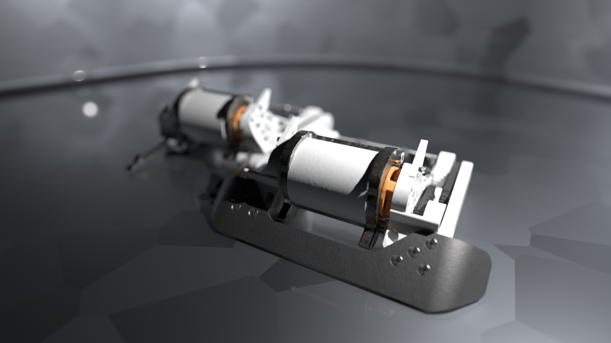
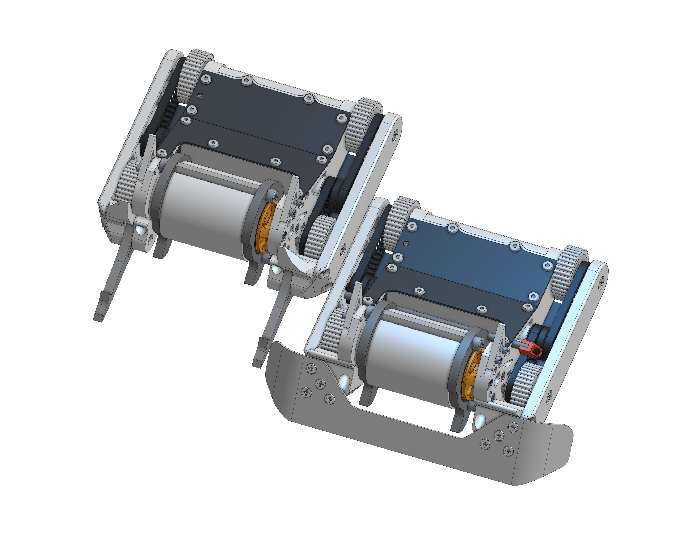

# white-noise
My first attempt at a 1lb Competitive Control &amp; Drisk Spinner Combat robot to compete in botbrawl!  

# Images

### Rendered

### In CAD

# Features

- **4WD**, using two Repeat Mini Brushed Mk2 motors, driven to the wheels with HTD 3mm, 4mm wide belts. 

- **Custom Molded Wheels**, using polyurthaine with bumps to maximize grip, even when dust comes in contact with the wheels

- **Drisk Spinner**, uses two 3/16" ar500 disks on the spinner to deal damage to apponents, powered by a Repeat 2822 Mk3

- **4S LiHV**, 17.4V allowing for a max theoretical DT speed of 5.6 MPH and 30K free spin RPM on the Spinner

- **Boiled Nylon Sides**, this allows for it to act like tpu, while being much stronger and difficult to break

- **CF Plates** Sandwiching the Nylon sides creates a super strong structure, allowing for some parts to absorb impact, while making the chassis still ridgid and keeping the robot together

## Countering Other Robot Archetypes
It's important to counter other robot archetypes to prevent anyweakness in this robot. Currently there are two, though more are to come.

### Wedge
- to counter horizontal spinners, as it uses the Repeat Titanium Wedge deflecting their blade
- Instead of allowing all the energy to be hit into the weaker nylon sides.

### Fork 
- to counter everything else, with its silicone pillows to actively push them against the ground to more actively win ground game
- They are also longer to out reach most other robots

# The Math
- I made a calculation of this robot here: [the-math.csv](Calcuations/the-math.csv)

# BOM + Weight Breakdown

|Weight Distro |FIELD2                       |FIELD3  |FIELD4|FIELD5    |FIELD6       |FIELD7                    |Sourcing          |FIELD9                |
|--------------|-----------------------------|--------|------|----------|-------------|--------------------------|------------------|----------------------|
|              |                             |        |      |          |             |                          |                  |                      |
|Subsystem     |Part Name                    |Mass (g)|QTY   |Total Mass|% to 1lb     |Notes                     |Vendor/Status     |Sourcing Specifics Doc|
|Spinning Mass |Weapon Disk                  |30.11053|2     |60.22106  |13.26455066  |                          |SCS               |in part-sourcing.csv  |
|              |Standoff                     |6.85    |2     |13.7      |3.017621145  |                          |Aliexpress        |in part-sourcing.csv  |
|              |M4 Screws                    |2.22687 |4     |8.90748   |1.962        |                          |Already Have      |                      |
|              |3DP Hub                      |19.67   |1     |19.67     |4.332599119  |3 Wall 15% Gyroid         |3D Printed Nylon  |                      |
|              |TPU Sock                     |1.71    |1     |1.71      |0.3766519824 |100% infill               |3D Printed Nylon  |                      |
|Rails         |Inner Rail                   |11.14   |2     |22.28     |4.907488987  |3 Wall 20% Gyroid         |3D Printed Nylon  |                      |
|              |Outer Rail                   |6.06    |2     |12.12     |2.669603524  |2 Wall 10% Gyroid         |3D Printed Nylon  |                      |
|              |Ears                         |0.44    |2     |0.88      |0.1938325991 |3 Walls                   |3D Printed Nylon  |                      |
|Middle Covers |Back Bumper                  |5.41    |1     |5.41      |1.191629956  |3 Walls 15% Gyroid        |3D Printed Nylon  |                      |
|              |Front Cover                  |5.72    |1     |5.72      |1.259911894  |2 Walls 3% Gyroid         |3D Printed Nylon  |                      |
|CF Plates     |Top CF Plate                 |3.63    |1     |3.63      |0.7995594714 |                          |CNC Madness       |in part-sourcing.csv  |
|              |Angled CF Plate              |2.92    |1     |2.92      |0.6431718062 |                          |CNC Madness       |in part-sourcing.csv  |
|              |Bottom CF Plate              |11.07   |1     |11.07     |2.438325991  |                          |CNC Madness       |in part-sourcing.csv  |
|Misc. Hardware|M3 Tap Screws                |0.47546 |35    |16.6411   |3.665440529  |                          |Aliexpress        |in part-sourcing.csv  |
|              |DT Shoulder Screw            |2.5     |4     |10        |2.202643172  |                          |Aliexpress        |in part-sourcing.csv  |
|              |DT Heatset Insert            |0.23    |4     |0.92      |0.2026431718 |                          |Already Have      |                      |
|              |M3x8mm Weapon Motor Screws   |0.9301  |4     |3.7204    |0.8194713656 |                          |Already Have      |                      |
|              |Weapon Dead Axle             |1       |1     |1         |0.2202643172 |                          |Repeat Robotics   |in part-sourcing.csv  |
|              |M3x16mm screw for Weapon Axle|1       |1     |1         |0.2202643172 |                          |Repeat Robotics   |in part-sourcing.csv  |
|              |5x8x2.5 Weapon Bearing       |1.6     |2     |3.2       |0.704845815  |                          |Aliexpress        |in part-sourcing.csv  |
|              |Weapon M3x9x.8 Washer        |0.36    |1     |0.36      |0.07929515419|                          |Aliexpress        |in part-sourcing.csv  |
|              |4x7x2.5 DT Bearing           |1       |8     |8         |1.762114537  |                          |Aliexpress        |in part-sourcing.csv  |
|              |M2 Drive Motor Screw         |0.26    |4     |1.04      |0.2290748899 |                          |Aliexpress        |in part-sourcing.csv  |
|              |M2 Screws for Ear            |0.35606 |4     |1.42424   |0.3137092511 |                          |Already Have      |                      |
|DT            |44T Belt                     |1.44    |2     |2.88      |0.6343612335 |                          |Aliexpress        |in part-sourcing.csv  |
|              |35T Belt                     |1.2     |1     |1.2       |0.2643171806 |                          |Aliexpress        |in part-sourcing.csv  |
|              |Wheel Rim                    |1.6     |4     |6.4       |1.40969163   |                          |Molded Polyurthane|in part-sourcing.csv  |
|              |Wheel Hub                    |3       |4     |12        |2.643171806  |Outside Is Gyroid, 3 Walls|3D Printed Nylon  |                      |
|              |Pulley                       |1.91    |2     |3.82      |0.8414096916 |4 Wall 15% Gyroid         |3D Printed Nylon  |                      |
|Electronics   |Drive Motors                 |27.5    |2     |55        |12.11453744  |                          |Repeat Robotics   |in part-sourcing.csv  |
|              |Drive ESC                    |9       |1     |9         |1.982378855  |                          |Repeat Robotics   |in part-sourcing.csv  |
|              |Weapon ESC                   |6       |1     |6         |1.321585903  |                          |Repeat Robotics   |in part-sourcing.csv  |
|              |Weapon Motor                 |46      |1     |46        |10.13215859  |                          |Repeat Robotics   |in part-sourcing.csv  |
|              |4s Battery                   |43      |1     |43        |9.471365639  |                          |Aliexpress        |in part-sourcing.csv  |
|              |ESR4 Reciever                |3       |1     |3         |0.6607929515 |                          |Aliexpress        |in part-sourcing.csv  |
|              |Screw Switch                 |2.5     |1     |2.5       |0.550660793  |                          |Repeat Robotics   |in part-sourcing.csv  |
|Base Chassis  |                             |        |      |406.34428 |89.50314537  |                          |                  |                      |
|              |                             |        |      |          |             |                          |                  |                      |
|Fork Config   |Fork Holder                  |5.225   |2     |10.45     |2.301762115  |6 Wall 25% Gyroid         |3D Printed Nylon  |                      |
|              |Fork                         |12.92883|2     |25.85766  |5.695519824  |                          |SCS               |in part-sourcing.csv  |
|              |Fork Pillow                  |0.21352 |2     |0.42704   |0.09406167401|                          |Molded Polyurthane|in part-sourcing.csv  |
|              |M3 x 12mm Screw              |1.14895 |2     |2.2979    |0.5061453744 |                          |Already Have      |                      |
|              |                             |        |      |39.0326   |8.597488987  |                          |                  |                      |
|              |With Chassis                 |        |      |445.37688 |             |                          |                  |                      |
|              |                             |        |      |          |             |                          |                  |                      |
|Wedge Config  |Wedge Mount                  |5       |2     |10        |2.202643172  |4 Wall 15% Gyroid         |3D Printed Nylon  |                      |
|              |Wedge                        |28.2    |1     |28.2      |6.211453744  |                          |Repeat Robotics   |in part-sourcing.csv  |
|              |#4 Screws                    |0.525   |6     |3.15      |0.6938325991 |                          |Comes With Wedge  |                      |
|              |                             |        |      |41.35     |9.107929515  |                          |                  |                      |
|              |With Chassis                 |        |      |447.69428 |             |                          |                  |                      |

# License
This project is available under the MIT License. See [LICENSE](LICENSE) for details.